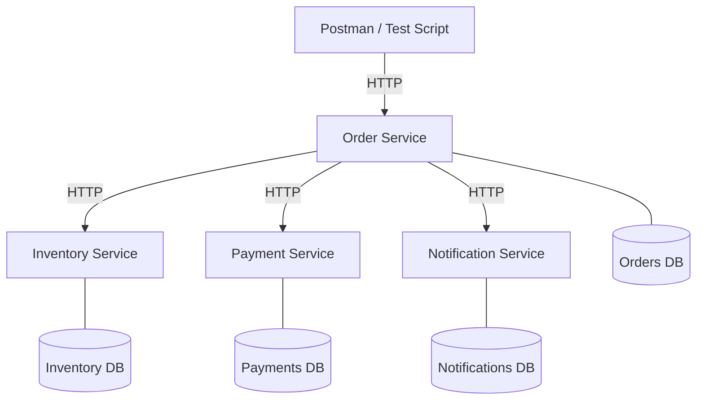
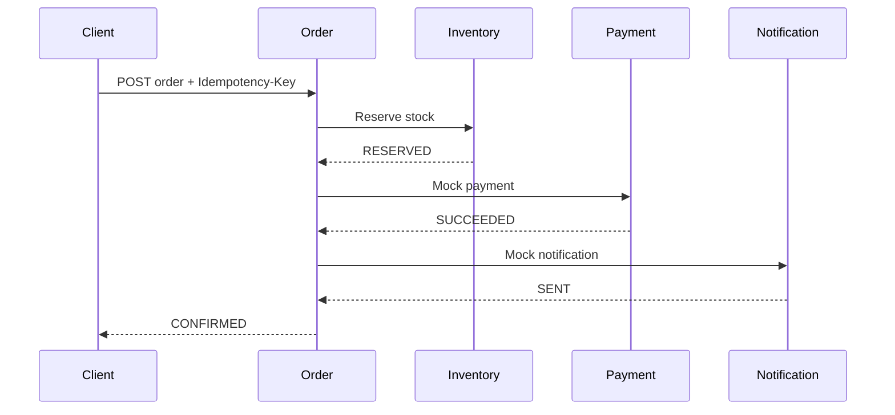
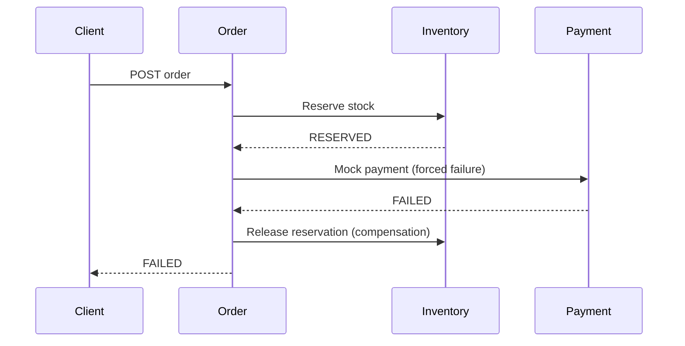

# Technical Report Outline (max 15 pages, excluding appendices)

1. **Problem and scope** — ShopFlow problem, assumptions, out-of-scope features.
2. **Business rules**
   - BR1: inventory quantity must never become negative.
   - BR2: repeated `Idempotency-Key` + same payload returns original result.
   - BR3: same key + different payload returns HTTP 409.
   - BR4: payment failure releases reserved stock and leaves order FAILED.
   - BR5: notification failure must not reverse successful payment/order confirmation.
3. **Service decomposition** — responsibility, owned data, rejected alternatives.
4. **Architecture** — component diagram and sequence diagram with happy/failure paths.
5. **Data design** — per-service ER diagram; references stored as IDs only.
6. **API design** — endpoint table, request/response examples, status/error format, Swagger links.
7. **Engineering challenges** — concurrency, idempotency, resilience; scripts, evidence, limitations.
8. **Testing** — BR-to-test traceability and results.
9. **Trade-offs** — synchronous orchestration vs event-driven; SQLite vs PostgreSQL; mock vs real provider.
10. **Limitations/future work**.
11. **Appendix** — team contribution, individual reflection, AI-use declaration, demo link.

## Mermaid component diagram

## Happy path sequence

## Failure path sequence

